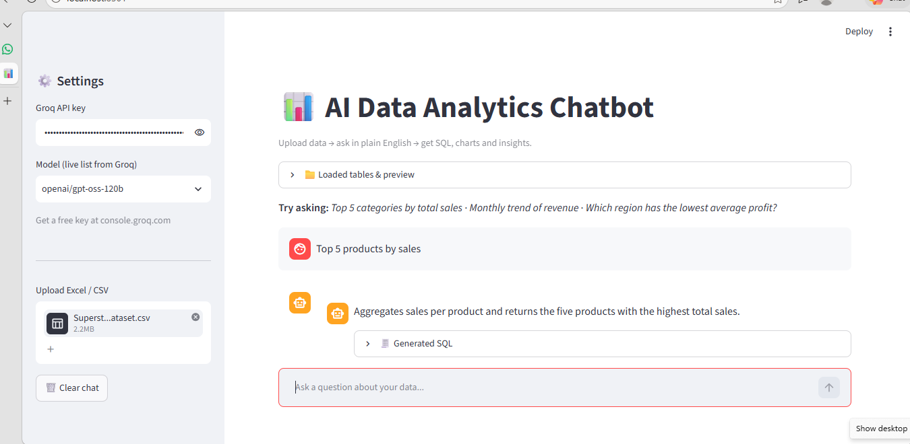
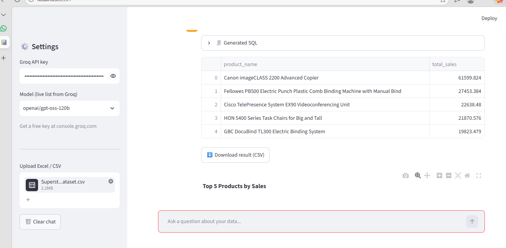
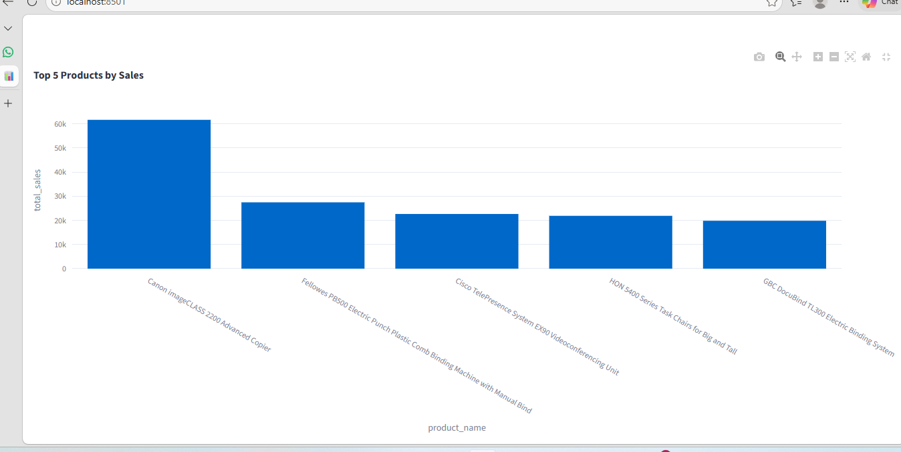

# 📊 AI Data Analytics Chatbot

Upload Excel/CSV, ask questions in plain English, and get SQL, charts and insights.

## Features
- Upload CSV / Excel files (multiple sheets supported)
- Natural language to SQL using Groq LLM
- Auto-generated charts (bar, line, pie, scatter, histogram)
- AI-written business insights
- Read-only SQL safety guard and auto-retry on SQL errors
- Download query results as CSV

## Tech Stack
Python, Streamlit, SQLite, Pandas, Plotly, Groq API

## Screenshots




## Sample Result
See [results/result.csv](results/result.csv)

## Run Locally
```bash
git clone https://github.com/mandavitripathi25/ai-data-analytics-chatbot.git
cd ai-data-analytics-chatbot
pip install -r requirements.txt
export GROQ_API_KEY="your_key"
streamlit run app.py
```

## Example Questions
- Top 5 products by sales
- Monthly revenue trend
- Which region has the lowest profit?